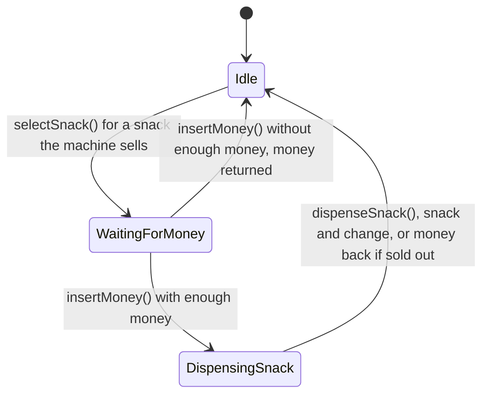
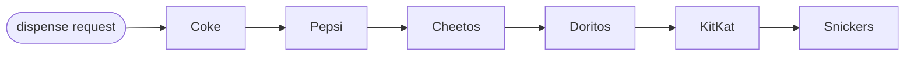

# Homework 11: Behavioral Design Patterns (State, Chain of Responsibility)

A Java vending machine that sells six snacks. It uses two behavioral design patterns:

- **State**: the machine is always in exactly one state: `Idle`, `WaitingForMoney`, or
  `DispensingSnack`. Each state is its own class. `VendingMachine` forwards every action
  (`selectSnack()`, `insertMoney()`, `dispenseSnack()`) to its current state, and that state
  decides what happens and which state comes next.
- **Chain of Responsibility**: dispensing goes through a chain of handlers, one per snack,
  in this order: Coke, Pepsi, Cheetos, Doritos, KitKat, Snickers. Each handler checks whether
  the request is for its snack. If it is not, the handler passes the request to the next one.
  The right handler dispenses the snack if there is at least one left, or reports that it is
  sold out.

## State diagram

The machine starts in `Idle`.

## What each state does with each action

Each column is one state class, and each row is one method of `StateOfVendingMachine`.

| Action | `Idle` | `WaitingForMoney` | `DispensingSnack` |
|---|---|---|---|
| `selectSnack(name)` | Sold here: remember it, go to `WaitingForMoney`. Not sold here: stay | A snack is already selected: stay | Busy: stay |
| `insertMoney(amount)` | No snack selected yet: return the money, stay | At least the price: keep it, go to `DispensingSnack`. Less: return it, go to `Idle` | Busy: return the money, stay |
| `dispenseSnack()` | Nothing to dispense: stay | Not paid yet: stay | Ask the chain to dispense. In stock: give the snack and change. Sold out: return the money. Go to `Idle` |

## Dispensing chain

